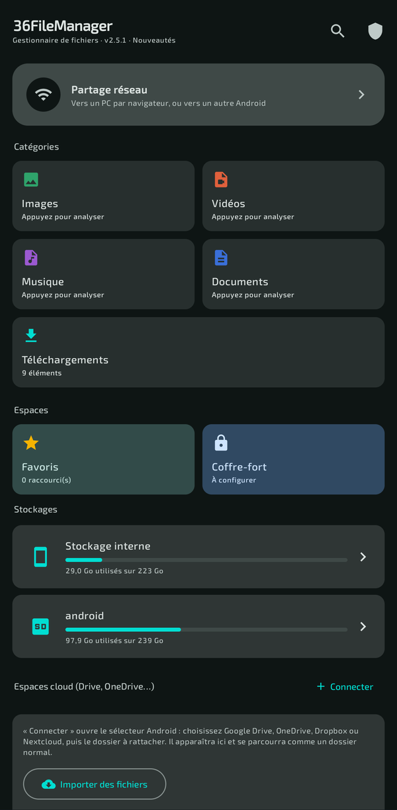
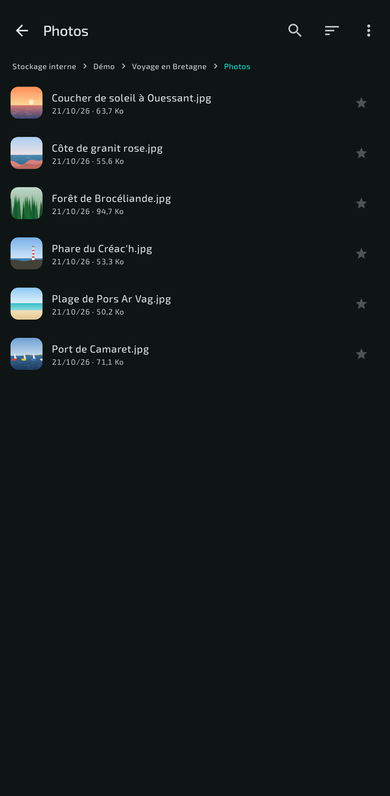
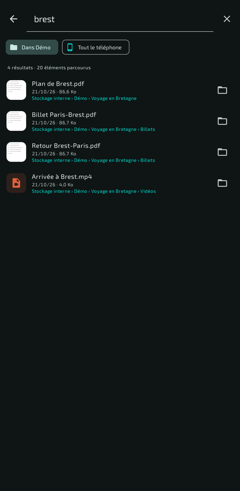
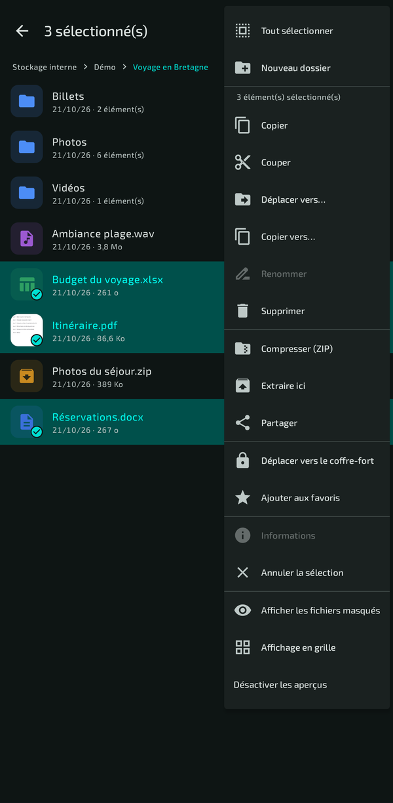
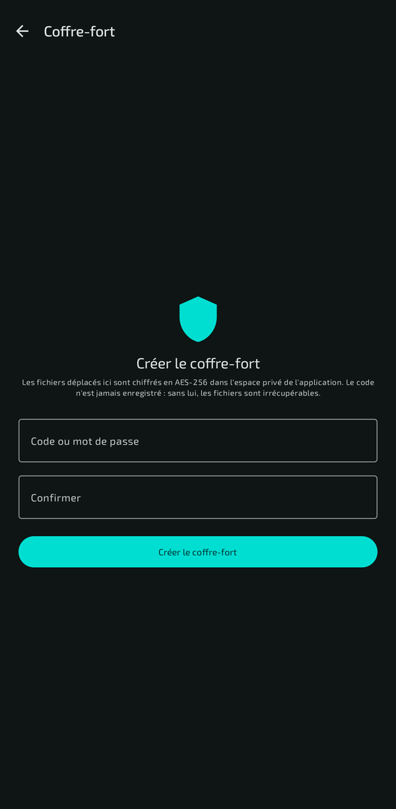
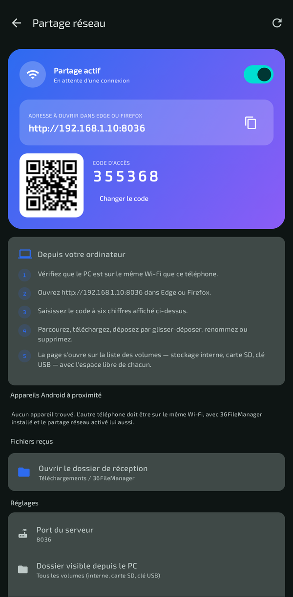
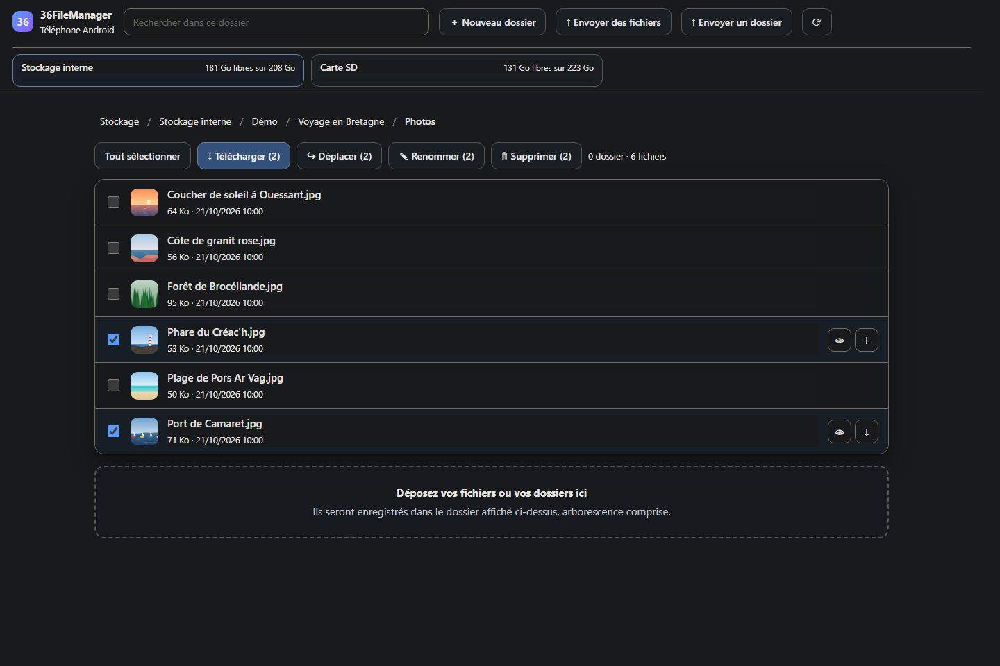

# 36FileManager

**Tous vos fichiers, et ceux de votre PC.** Un gestionnaire de fichiers complet pour Android :
stockage interne, carte SD et clé USB, coffre-fort chiffré, lecteurs réseau de la maison — et le
téléphone ouvert dans le navigateur de votre PC, pour échanger des fichiers sans câble et sans
rien installer dessus.

**[⬇ Télécharger l'APK](https://github.com/36txXnxTrGXgSH/36FileManager/releases/latest)** · **[Page de présentation](https://36txXnxTrGXgSH.github.io/36FileManager/)**

> 🔒 **Vos fichiers restent chez vous** — aucun compte, aucune publicité, aucune statistique
> envoyée, aucun serveur de l'application. 36FileManager ne se connecte qu'aux machines que vous
> lui indiquez (vos lecteurs partagés) et à votre PC quand vous activez le partage, qui ne s'ouvre
> que sur le Wi-Fi, jamais sur les données mobiles. Les espaces cloud (Drive, OneDrive…) passent
> par l'application du fournisseur, déjà installée sur votre téléphone.
>
> 🇫🇷 **Application en français uniquement** — menus, messages et documentation n'existent qu'en
> français.
>
> 🤖 **Entièrement réalisée avec Claude**, l'intelligence artificielle d'Anthropic : conception,
> code, tests et documentation.

<table>
  <tr>
    <td align="center"><br><sub>Accueil</sub></td>
    <td align="center"><br><sub>Aperçus des fichiers</sub></td>
    <td align="center"><br><sub>Recherche</sub></td>
  </tr>
  <tr>
    <td align="center"><br><sub>Actions sur une sélection</sub></td>
    <td align="center"><br><sub>Coffre-fort chiffré</sub></td>
    <td align="center"><br><sub>Partage avec le PC</sub></td>
  </tr>
</table>

<p align="center"><br><sub>Le téléphone dans le navigateur du PC</sub></p>

<sub>Les fichiers, dossiers et photos des captures sont fictifs.</sub>

## Installer

1. Téléchargez l'APK depuis la [dernière version publiée](https://github.com/36txXnxTrGXgSH/36FileManager/releases/latest).
2. Ouvrez-le sur votre téléphone (Android 8.0 ou plus récent) ; Android demande d'autoriser
   l'installation depuis cette source.
3. Au premier lancement, accordez « Accès à tous les fichiers » : c'est ce qui permet de
   parcourir et de modifier le stockage.
4. Pour mettre à jour, installez la nouvelle version par-dessus : favoris, réglages et coffre-fort
   sont conservés.

> ⚠️ Le coffre-fort vit dans l'espace privé de l'application : **désinstaller le détruit**.
> Restaurez son contenu vers le stockage avant toute désinstallation.

## Fiche technique

- **Version** : 2.5.1 (versionCode 21)
- **Package** : `com.filemanager36.app`
- **minSdk** 26 (Android 8.0) · **targetSdk / compileSdk** 35
- **AGP** 8.7.2 · **Kotlin** 2.0.21 · **Gradle** 8.14.3 · **JDK 17 à 21**

## Fonctionnalités

### Navigation
- Détection automatique de tous les volumes : stockage interne, carte SD, clé USB / OTG
  (via `StorageManager` + balayage de repli de `/storage`, `/mnt/media_rw`, `/mnt/usb`).
- Fil d'Ariane cliquable, affichage liste ou grille, recherche dans le dossier courant.
- Tri par **nom**, **taille** ou **date d'ajout**, ordre croissant/décroissant, dossiers en premier.
- Affichage ou masquage des fichiers cachés, réglage global mémorisé.

### Opérations (fichiers **et** dossiers, y compris tout leur contenu)
Copier · couper · coller · déplacer vers… · copier vers… · renommer · supprimer ·
compresser en ZIP · extraire une archive · informations détaillées · partager.

- Sélection multiple par appui long, **« Tout sélectionner »** dans le menu « ⋮ ».
- Anti-écrasement automatique (`photo.jpg` → `photo (1).jpg`), protection Zip-Slip,
  refus des déplacements d'un dossier dans lui-même, et **aucune traversée de lien
  symbolique** : supprimer `/sdcard` efface le lien, jamais le stockage qu'il désigne.
- Barre de progression pour les opérations longues.

### Coffre-fort
- Code (ou mot de passe) + déverrouillage **biométrique** facultatif.
- Chiffrement réel **AES-256** :
  - clé de données aléatoire (DEK) chiffrant le contenu des fichiers (AES-256-CBC en flux) ;
  - DEK emballée par une clé dérivée du code (PBKDF2-HMAC-SHA256, 120 000 itérations) ;
  - option biométrie : DEK également scellée par une clé Android Keystore
    `setUserAuthenticationRequired(true)` + `BiometricPrompt.CryptoObject` ;
  - index du coffre chiffré en AES-GCM ; le code n'est **jamais** stocké ;
  - contenu **authentifié** par HMAC-SHA256 (depuis la 2.1.0) : une altération du fichier
    chiffré est détectée à la restauration au lieu de produire un fichier corrompu
    présenté comme valide. Les coffres créés avant la 2.1.0 continuent de s'ouvrir
    normalement.
- Accessible depuis une carte dédiée sur l'accueil.
- Action « Déplacer vers le coffre-fort » sur n'importe quelle sélection ; les dossiers sont
  compressés puis chiffrés. Restauration vers le dossier de votre choix.

> Les fichiers du coffre vivent dans l'espace privé de l'application : désinstaller
> 36FileManager les détruit. Restaurez avant toute désinstallation.

### Favoris
Raccourcis purs : le fichier n'est ni copié ni déplacé.

- **Un seul espace Favoris** : la tuile de l'accueil ouvre l'écran dédié, où les raccourcis
  sont séparés en *Dossiers* et *Fichiers*, triables, avec par entrée : ouvrir, ouvrir
  l'emplacement, partager, informations, retirer. (L'ancienne liste d'aperçu sur l'accueil
  a été supprimée : elle faisait doublon.)
- Les raccourcis cassés sont signalés en rouge ; « Retirer les raccourcis cassés » les purge.
- Métadonnées relevées en arrière-plan : un favori sur une carte SD retirée ne fige pas l'écran.

### Toutes les actions dans le menu « ⋮ »
Il n'y a **aucune barre d'outils en bas d'écran** : elle entrait en conflit avec la navigation
gestuelle d'Android. Toutes les opérations sur une sélection (copier, couper, coller, déplacer
vers…, copier vers…, renommer, supprimer, compresser, extraire, partager, coffre-fort, favoris,
envoi réseau, envoi cloud, informations, vider le presse-papiers) sont dans le menu « ⋮ » de la
barre supérieure, à côté de « Tout sélectionner ». Idem pour le coffre-fort, les lecteurs
réseau et les espaces cloud.

### Catégories : Images, Vidéos, Musique, Documents
Quatre dossiers virtuels sur l'accueil qui rassemblent **tous** les fichiers d'un type,
quel que soit leur dossier ou leur volume.

- Images : jpg, png, gif, webp, heic, bmp, avif, svg…
- Vidéos : mp4, mkv, avi, mov, webm, 3gp, m4v…
- Musique : mp3, flac, m4a, wav, ogg, opus, aac, wma…
- Documents : pdf, doc/docx, xls/xlsx, ppt/pptx, odt/ods/odp, txt, md, csv, rtf, epub

**Deux modes d'affichage**, mémorisés, dans le menu « ⋮ » :

- *tous les fichiers* — tout en vrac, trié selon le réglage courant ;
- *par dossier* — la catégorie liste les dossiers qui contiennent ce type de fichiers,
  avec le nombre d'éléments, le poids total, le chemin et la vignette du fichier le plus
  récent. On entre dans un dossier pour n'y voir que les fichiers de la catégorie.

Double source : index multimédia d'Android **plus** un parcours réel des volumes, fusionnés
par chemin, ce qui rattrape les fichiers jamais indexés. « Réanalyser l'appareil » relance
l'analyse, qui est annulable et ne repart pas d'elle-même après chaque opération.

### Visionneuse à balayage
Toucher une image ou un PDF ouvre une visionneuse plein écran.
**Un balayage horizontal passe au fichier suivant du dossier** — ou de la catégorie.

- **Images** : zoom par pincement, double-appui pour agrandir, déplacement borné au cadre.
  Le balayage reste actif tant que l'image n'est pas agrandie (`canPan` sur le modificateur
  `transformable` : sans ce filtre, le zoom capte tous les glissements). Bouton **Modifier**
  qui ouvre la photo dans les outils de retouche du téléphone via `ACTION_EDIT`, avec
  l'autorisation d'écriture pour enregistrer par-dessus l'original.
- **PDF** : aperçu de la première page avec le nombre total, puis ouverture du document
  entier dans une application dédiée.
- Barre supérieure escamotable d'un appui : nom, position, retouche, favori, partage,
  ouverture externe, informations.

### Ouvrir un fichier : APK, archives, texte
Toucher un fichier ne se contente plus de déléguer au sélecteur d'Android — ce qui
laissait certains formats, `.apk` en tête, sans aucun effet visible.

- **`.apk`** : une fiche s'ouvre avec l'icône réelle de l'application, son nom, sa
  version, son identifiant de paquet et sa taille, plus la version déjà installée le
  cas échéant (le bouton devient alors « Mettre à jour »). L'installation exige deux
  choses côté Android : l'autorisation `REQUEST_INSTALL_PACKAGES` (déclarée) **et**
  le réglage « Installer des applications inconnues » activé pour 36FileManager. Tant
  qu'il ne l'est pas, la fiche l'explique et un bouton **Autoriser** mène droit à
  l'écran système ; l'état est revérifié au retour. Un APK exigeant une version
  d'Android supérieure à celle du téléphone est signalé avant l'échec.
- **Archives `.zip`** : extraction intégrée, dans un dossier créé à côté de l'archive.
  Une archive vide, chiffrée ou mal nommée est signalée au lieu d'annoncer un succès.
- **Texte** (txt, log, json, xml, sous-titres, code, configuration…) : visionneuse
  intégrée en police à chasse fixe, avec balayage vers le fichier suivant. Beaucoup de
  téléphones n'ont aucune application déclarant `text/plain` : le sélecteur système
  s'ouvrait vide. Lecture bornée à 256 Kio, rendu ligne par ligne, lignes très longues
  découpées — un JSON minifié ne fige plus l'affichage.
- **HTML, CSV, Markdown** partent au navigateur ou au tableur du téléphone quand il y
  en a un, et ne retombent sur la visionneuse texte que sinon.
- **Format inconnu** : au lieu d'un sélecteur vide, une boîte **« Ouvrir en tant
  que… »** propose toutes les applications, ou d'imposer un type (texte, image, vidéo,
  audio) — de quoi ouvrir un fichier mal nommé.

### Vidéos et musique : remise à une application dédiée
**Aucun lecteur intégré.** Un lecteur ExoPlayer avait été tenté puis retiré : il faisait
planter l'application, et VLC ou MX Player gèrent de toute façon bien plus de formats, de
pistes audio et de sous-titres qu'un lecteur minimal.

- Toucher une vidéo ou un morceau dans une liste ouvre directement le sélecteur du système.
- Depuis la visionneuse (en balayant sur un média au milieu de photos), une page dédiée
  affiche la vignette du fichier — image extraite de la vidéo ou pochette du morceau — et
  la **rangée des applications installées capables de le lire**, avec leur icône : un seul
  appui pour lancer VLC. Plus un bouton « Autre application… » vers le sélecteur complet.
- Le balayage vers le fichier suivant continue de fonctionner sur ces pages.

### Partage réseau — vers un PC, ou vers un autre Android
Une carte en couleur, en haut de l'accueil, ouvre l'écran dédié. Un interrupteur suffit.

**Vers l'ordinateur (Windows, macOS, Linux) — par le navigateur.**
Le téléphone devient une page web. L'écran affiche l'adresse à taper dans Edge ou
Firefox (`http://192.168.x.y:8036`), un **QR code** et un **code d'accès à six chiffres**.
Depuis cette page : parcourir le téléphone, prévisualiser, télécharger un fichier, un
dossier entier (compressé à la volée) ou une sélection, et **déposer des fichiers par
glisser-déposer** — fichiers comme dossiers entiers — avec une barre de progression par
fichier, une file d'attente, un bouton « Relancer » sur les échecs et le traitement des
doublons. Rien à installer côté PC.

**Tous les volumes, et l'espace qu'il reste (2.3.0).** La page s'ouvre sur une vue
**Stockage** : stockage interne, carte SD, clé USB, chacun avec son espace libre, son
espace utilisé et une barre de remplissage. L'en-tête rappelle ces volumes **sur toutes
les pages** — un appui bascule d'un volume à l'autre — de sorte que l'espace restant est
toujours sous les yeux, y compris pendant un dépôt de fichiers. Pour ne partager qu'un
dossier, choisissez-le dans *Dossier visible depuis le PC* ; la croix à côté du réglage
ramène à tous les volumes.

**Renommer et supprimer depuis le PC.** Un élément coché : les boutons ✎ et 🗑 sont sur
sa ligne. Plusieurs : ils passent dans la barre du haut, avec le nombre d'éléments visés
— « ✎ Renommer (3) », « 🗑 Supprimer (3) ». Renommer une sélection enchaîne les invites,
une par élément, et « Annuler » arrête la série. La suppression est **définitive** : il
n'y a pas de corbeille, un dossier part avec tout son contenu, et le navigateur demande
confirmation. Un réglage séparé de l'autorisation de dépôt — *Autoriser le renommage et
la suppression* — permet de fermer ce pouvoir : le téléphone refuse alors la requête, et
les boutons disparaissent de la page au listage suivant.

**Vers un autre téléphone Android.**
Les deux appareils activent le partage ; ils se découvrent en diffusion UDP sur le
réseau local. On choisit l'appareil, puis les fichiers dans le navigateur de
l'application ; le destinataire reçoit une notification et une demande d'acceptation
détaillant les fichiers et leur volume. Rien n'est écrit avant son accord. Les fichiers
reçus atterrissent dans *Téléchargements / 36FileManager*.

**Ce qui protège cette ouverture sur le réseau** — un serveur accessible depuis le LAN
demande plus de précautions que le reste de l'application :

| Mesure | Raison |
|---|---|
| **Le partage ne s'ouvre que sur Wi-Fi ou Ethernet**, sur une adresse privée | les interfaces de données mobiles et de VPN sont exclues : chez certains opérateurs, s'y lier rendrait le téléphone joignable depuis Internet |
| Refus de tout client hors réseau privé | seconde barrière, indépendante de la première |
| Code à 6 chiffres tiré au sort cryptographiquement, comparé à temps constant ; 6 essais puis blocage d'une minute, demi-seconde d'attente par échec | rend la recherche exhaustive irréalisable |
| En-tête `Host` obligatoirement une adresse IP | bloque l'attaque par redécouverte DNS |
| **Contrôle d'origine** (`Sec-Fetch-Site`, `Origin`, `Referer`), cookie `SameSite=Strict; HttpOnly`, session expirant en 24 h | un site web consulté pendant le partage ne peut pas agir sur le téléphone |
| **Aperçu limité aux images, vidéos, audio, PDF et texte brut** ; `nosniff` partout ; page sous `Content-Security-Policy` | un `.html` ou un `.svg` présent sur le téléphone ne peut pas s'exécuter dans l'origine du serveur et aspirer le stockage |
| Volumes partagés cloisonnés (chemins canoniques) ; la racine « / » du système en est exclue | `?path=../..` ne sort ni du dossier choisi ni des volumes listés |
| Renommage et suppression **fermés par défaut**, sous un réglage distinct du dépôt ; en-tête maison exigé sur ces deux seules routes | la page ne peut rien détruire tant que l'utilisateur ne l'a pas décidé, et aucun site tiers ne peut fabriquer la requête |
| Envoi entre appareils borné par la proposition acceptée | nom, nombre et volume annoncés sont vérifiés à la réception |
| 24 connexions, 8 par machine, délai de 20 s | un voisin ne peut pas saturer le serveur |
| Service de premier plan avec notification et bouton « Arrêter » | un partage actif reste visible |

Le partage s'arrête si l'application est balayée hors des tâches récentes, et se
rebranche tout seul quand l'adresse IP change ou que le Wi-Fi revient.

> Le trafic circule **en clair** sur le réseau local : c'est du HTTP, pas du HTTPS. Un
> certificat auto-signé imposerait un avertissement de sécurité à chaque connexion, ce
> qui apprendrait surtout à passer outre les avertissements. Utilisez le partage sur un
> réseau de confiance, et coupez-le quand vous avez fini — le bouton « Arrêter » est dans
> la notification.

### Espaces cloud (Google Drive, OneDrive, Dropbox, Nextcloud…)
Accès par le système de documents d'Android (SAF) — aucun compte développeur, aucune clé d'API.

- « Connecter » rattache un dossier cloud une fois pour toutes (autorisation persistante).
- Navigation dans l'espace cloud avec fil d'Ariane, sélection multiple, récupération vers
  le stockage local, envoi d'un dossier local, création de dossier, renommage, suppression.
- « Envoyer vers le cloud » apparaît aussi dans les actions de sélection du navigateur.
- Repli « Importer des fichiers » (sélection fichier par fichier) pour les fournisseurs,
  Google Drive en tête, qui refusent le rattachement d'un dossier entier.

### Partage
Partage d'un ou plusieurs fichiers via le sélecteur Android (WhatsApp, Gmail, Bluetooth,
Drive…) grâce à un `FileProvider`. Un dossier sélectionné est automatiquement compressé
en ZIP avant partage.

### Mini-aperçus
Vignette carrée à côté du nom pour les **images**, **vidéos** (extraction d'image),
**PDF** (`PdfRenderer`), **pochettes audio** et **icônes d'APK**. Cache mémoire LRU,
génération hors du fil principal, désactivable dans le menu.

### Lecteurs réseau LAN (SMB / CIFS)
Connexion en deux étapes, sans jamais avoir à connaître le nom d'un partage.

1. **Adresse IP** de la machine (+ choix du système : Windows, Linux, Android, NAS,
   qui adapte l'aide, le domaine et le port — Android ne peut pas ouvrir le 445, 4455
   est proposé).
2. **Identifiant et mot de passe** (ou « connexion invité »).

L'application interroge alors la machine et **liste tous ses dossiers partagés** — exactement
ce que fait l'Explorateur Windows quand on saisit `\\192.168.1.20`. Techniquement :
`NetrShareEnum` du service MS-SRVS, sur le tube nommé `IPC$` (bibliothèque rapid7 dcerpc
au-dessus de smbj). Les partages d'impression et `IPC$` sont écartés ; les partages
administratifs (`C$`, `ADMIN$`) sont listés et signalés comme tels.

Ensuite : navigation dans le partage choisi, création de dossier, renommage, suppression
côté serveur, récupération de fichiers ou de dossiers entiers vers le stockage local, envoi
d'un dossier local ou de la sélection courante du navigateur. Le retour remonte
dossier → racine du partage → liste des partages → accueil. Les serveurs enregistrés
se reconnectent en un appui depuis l'accueil, avec mémorisation du dernier partage ouvert.

Les échecs sont traduits en clair : identifiants refusés, pas de réponse, partage de
fichiers désactivé, compte sans mot de passe…

## Portée réelle de l'accès aux fichiers
Un écran « Accès aux fichiers » (bouclier, en haut de l'accueil) dresse le bilan volume par
volume. En résumé, avec l'autorisation « Accès à tous les fichiers » accordée :

| Zone | Accès |
|---|---|
| Stockage interne partagé | lecture + écriture |
| Carte SD, clé USB / OTG | lecture + écriture |
| Racine du système `/` (visible comme volume) | lecture seule |
| `Android/data`, `Android/obb` | **bloqués par Android 11+**, pour toutes les applications |
| Données privées des autres applications (`/data/data`) | **impossible sans root** |
| Partitions système (`/system`, `/vendor`) | lecture seule |
| Profil professionnel / second utilisateur | invisible, cloisonné par Android |

Les trois lignes en gras ne sont pas des limites de 36FileManager : aucune application
non rootée ne peut les franchir depuis Android 11.

## Autorisations
- Android 11+ : `MANAGE_EXTERNAL_STORAGE` (écran système « Accès à tous les fichiers »).
- Android 8–10 : `READ/WRITE_EXTERNAL_STORAGE` + `requestLegacyExternalStorage`.
- `INTERNET` / `ACCESS_WIFI_STATE` pour les lecteurs réseau, `USE_BIOMETRIC` pour le coffre.
- `REQUEST_INSTALL_PACKAGES` pour installer un `.apk` depuis l'application.
- `FOREGROUND_SERVICE` + `FOREGROUND_SERVICE_DATA_SYNC`, `WAKE_LOCK`,
  `POST_NOTIFICATIONS`, `CHANGE_WIFI_MULTICAST_STATE` pour le partage réseau.
  (Sur Google Play, cette autorisation est « restreinte » : une publication exigerait
  le formulaire de déclaration correspondant. Sans effet pour un APK de test.)

## Compilation

```bash
./gradlew assembleDebug        # APK de débogage  (~23,6 Mo)
./gradlew assembleRelease      # APK à installer  (~16,7 Mo)
./gradlew testDebugUnitTest    # tests JVM du lecteur multipart
```

Les deux APK sont signés avec la clé du projet (ci-dessous) : ils s'installent tels
quels, sans étape supplémentaire.

Renseignez `local.properties` avec `sdk.dir=/chemin/vers/Android/Sdk` — **avec des barres
obliques, même sous Windows** (`sdk.dir=C:/chemin/vers/Android/Sdk`) — ou
ouvrez simplement le dossier dans Android Studio.

> **Le JDK compte.** Gradle 8.14.3 accepte un JDK **17 à 21**. Le JDK 25 livré dans
> `jbr/` par les versions récentes d'Android Studio n'est pas supporté ; utilisez plutôt
> le JDK 21 rangé dans `~/.jdks/jbr-21.x` :
> `JAVA_HOME=~/.jdks/jbr-21.0.11 ./gradlew assembleRelease`

### Signature des versions publiées
Les APK des *Releases* sont signés avec la clé du projet. Empreinte SHA-256 de son
certificat :

`ec15f53fdc8cb032dff9cb1c1d72e58b26bdc953b101a3116659f00d87345813`

À vérifier avant d'installer : `apksigner verify --print-certs 36FileManager-x.y.z.apk`.
Toutes les versions publiées portent ce même certificat : elles s'installent les unes
par-dessus les autres, sans perte de données.

**La clé privée n'est pas dans ce dépôt**, et ne doit jamais y entrer : quiconque la
détiendrait pourrait publier une fausse mise à jour qu'Android installerait par-dessus
l'application. Compiler depuis les sources donne donc :

- un APK *debug* signé par la clé de débogage de votre machine ;
- un APK *release* **non signé** (`app-release-unsigned.apk`), à signer vous-même.

Un APK compilé par vos soins ne s'installe pas par-dessus une version publiée (Android
refuse un changement de signature). Il faut d'abord désinstaller — et **restaurer avant
le contenu du coffre-fort**, détruit avec l'application.

Pour signer avec votre propre clé, créez à la racine un fichier `keystore.properties`
(ignoré par git) :

```properties
storeFile=chemin/vers/votre-cle.jks
storePassword=…
keyAlias=…
keyPassword=…
```

> **Changer de clé impose une désinstallation.** Android n'accepte jamais une mise à jour
> signée par une autre clé. Avant de désinstaller, **restaurez le contenu du coffre-fort**
> vers le stockage normal : il vit dans l'espace privé de l'application et disparaît
> avec elle. Les favoris, serveurs réseau et réglages sont également perdus.

## Structure

```
app/src/main/java/com/filemanager36/app/
├─ MainActivity.kt          hôte Compose, snackbar, superposition de progression
├─ FmApplication.kt
├─ data/
│  ├─ Models.kt             FileItem, volumes, favoris, serveurs, entrées du coffre
│  ├─ Prefs.kt              réglages + favoris + serveurs + matériel cryptographique
│  ├─ StorageRepo.kt        volumes, listage trié, fil d'Ariane
│  ├─ FileOperations.kt     copier/déplacer/supprimer/renommer/ZIP/infos
│  ├─ VaultCrypto.kt        PBKDF2, AES-GCM, AES-CBC, HMAC, clé Keystore biométrique
│  ├─ VaultRepository.kt    index chiffré, import/export du coffre
│  ├─ SmbRepository.kt      SMB/CIFS
│  ├─ CloudRepository.kt    SAF / DocumentsContract
│  ├─ MediaRepository.kt    catégories transversales
│  ├─ HttpShareServer.kt    serveur web embarqué (partage réseau)
│  ├─ MultipartReader.kt    lecture multipart en flux
│  └─ ShareRepository.kt    découverte UDP, propositions, transferts
├─ ui/
│  ├─ FmViewModel.kt        état global et actions
│  ├─ theme/                Material 3 clair/sombre + couleurs dynamiques
│  ├─ components/           vignettes, lignes, dialogues, sélecteur de dossier
│  └─ screens/              Accueil · Navigateur · Coffre-fort · Lecteur réseau ·
│                           Catégories · Favoris · Cloud · Partage · Visionneuse
├─ util/                    formats, types de fichiers, miniatures, partage,
│                           autorisations, biométrie, QR code,
│                           SafeName (noms venus du réseau),
│                           SecretStore (chiffrement Keystore des mots de passe)
└─ ShareService.kt          service de premier plan du partage réseau

app/src/main/assets/share/index.html   page servie au navigateur du PC
app/src/test/…/MultipartReaderTest.kt  tests JVM du lecteur multipart
```

## Nouveautés de la 2.5.1

- **Durée des morceaux et des vidéos** dans la fenêtre « Ce fichier existe déjà » de la page
  web, et taille exacte quand les deux tailles s'arrondissent pareil.
- **Corrigé** : dans la page web, cocher des fichiers active de nouveau les boutons
  Télécharger, Déplacer, Renommer et Supprimer (défaut de la 2.5.0) ; une recherche y indique
  de nouveau le nombre de résultats.
- Les tailles de la page web s'écrivent avec une virgule, comme dans l'application.

## Nouveautés de la 2.5.0

- **Recherche sur tout le téléphone** : l'icône loupe de l'accueil cherche dans tous les
  volumes ; dans un dossier, le filtre propose d'aller chercher dans les sous-dossiers.
  Accents et majuscules ignorés, mots dans n'importe quel ordre, résultats affichés au
  fil de l'eau avec le dossier où chacun se trouve. Un retour depuis un résultat ramène
  à la liste.
- **Recherche dans la page web**, avec le même moteur : les mêmes fichiers trouvés
  depuis le PC et depuis le téléphone.
- **Déplacer depuis la page web** : un fichier, un dossier ou une sélection, vers
  n'importe quel dossier, y compris sur un autre volume. Rien n'est jamais écrasé.
- **Tuile Téléchargements** à l'accueil, sous les catégories.
- **Fenêtre des nouveautés** : à la première ouverture d'une nouvelle version, une fenêtre
  présente ce qui a changé — toutes les versions sautées d'un coup. Jamais à la première
  installation. Pour la revoir, toucher le titre en haut de l'accueil.

## Nouveautés de la 2.4.0

Le dépôt de fichiers depuis le PC, repris de bout en bout.

- **Envoyer un dossier entier**, arborescence comprise, par le bouton dédié ou par
  glisser-déposer. Le téléphone recrée les sous-dossiers.
- **File d'attente** : deux envois avancent à la fois, les suivants attendent leur tour
  en le disant. Auparavant tout partait d'un coup et la plupart des fichiers restaient
  affichés « 0 % » sans que rien n'avance.
- **Bouton « Relancer »** sur chaque envoi en échec, et « Relancer les échecs » pour
  toute la file.
- **Doublons réglés avant l'envoi** : même nom et même taille, le fichier est ignoré —
  rien ne repart sur le réseau, rien n'est écrasé. Taille différente, vous choisissez :
  garder celui du téléphone, garder les deux, ou remplacer. Avec « appliquer à tous »
  pour ne pas répondre à chaque fichier.
- **Transferts stables écran éteint** : le téléphone garde son processeur éveillé le
  temps de chaque requête et tolère les pauses du Wi-Fi en veille. C'est la cause des
  « Connexion perdue » qui coupaient les envois dès que l'écran s'éteignait.

## Nouveautés de la 2.3.1

- **Le renommage et la suppression sont enfin visibles** : le réglage qui les commande
  était fermé par défaut, la fonction paraissait donc absente. Il est désormais ouvert
  — y compris sur les installations qui avaient déjà enregistré leurs réglages.
- **Place fixe des deux actions** : sur la ligne à un élément coché, dans la barre du
  haut dès qu'il y en a plusieurs, avec le compte.
- **Renommage en série** sur une sélection multiple.
- Fermer ou ouvrir une autorisation sur le téléphone prend effet dans le navigateur au
  listage suivant, sans avoir à recharger la page.

## Nouveautés de la 2.3.0

- **Vue Stockage dans la page web** : la carte SD et la clé USB sont désormais
  accessibles depuis le PC, plus seulement le stockage interne.
- **Espace disque affiché en permanence**, sur toutes les pages : libre, utilisé, et une
  barre par volume. Rien n'est affiché avant la saisie du code.
- Le réglage *Dossier visible depuis le PC* est réinitialisable : la croix ramène à tous
  les volumes.

## Nouveautés de la 2.2.0

- **Renommer et supprimer depuis le navigateur du PC** — sous un réglage désactivé par
  défaut (*Partage réseau → Autoriser le renommage et la suppression*). Boutons par
  ligne, suppression en lot sur la sélection, confirmation avant d'effacer.
- **Effacer l'historique des transferts** depuis l'écran de partage : le bouton
  « Effacer » vide le journal, en conservant les transferts encore en cours.
- Changer une autorisation pendant que le partage tourne ne coupe plus la session du
  navigateur : seuls le port, le dossier partagé et l'exigence d'un code redémarrent le
  serveur — et donc renouvellent le code.

## Nouveautés de la 2.1.0

Version de **durcissement** : aucune fonctionnalité nouvelle, l'usage est identique.

- Le partage réseau ne s'ouvre plus jamais sur les données mobiles ni sur un VPN.
- Un site web consulté pendant que le partage tourne ne peut plus agir sur le téléphone.
- L'aperçu dans le navigateur est limité aux formats qui ne peuvent pas exécuter de code.
- Code d'accès tiré cryptographiquement ; sessions expirant réellement au bout de 24 h.
- Mots de passe des lecteurs réseau chiffrés par l'AndroidKeystore.
- Contenu du coffre-fort authentifié (HMAC) — coffres existants compatibles.
- Les noms de fichiers venus d'un serveur SMB ou d'un espace cloud sont assainis.
- L'extraction d'une archive ZIP vérifie l'espace libre et refuse les bombes de
  décompression.
- **Correction** : deux téléphones du même modèle ne se voyaient pas dans la découverte.
- Divers : moins de mémoire retenue, QR code recalculé seulement quand l'adresse change,
  deux blocages d'interface supprimés.
